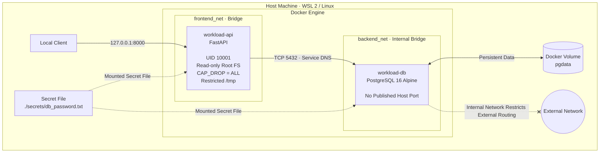

# 🔐 Secure Cloud Workload Portfolio

### Project 01 · Cloud Security Engineering · Container Hardening

A security-hardened, containerized application stack built to demonstrate practical **Cloud Security Engineering**, Docker isolation, network microsegmentation, secret management, least-privilege execution, and shift-left vulnerability scanning.

This project takes a conventional FastAPI + PostgreSQL application and hardens its runtime environment using layered container security controls. It also includes an unhardened baseline to make security improvements measurable and verifiable.

> **Security philosophy:** Minimize attack surface. Restrict privileges. Isolate workloads. Protect secrets. Verify everything.

---

## 📌 Project at a Glance

| :-------------------- | :------------------------------------------------------------- |
| **Project**           | Secure Cloud Workload Portfolio — Project 1                    |
| **Application**       | FastAPI + PostgreSQL 16                                        |
| **Containerization**  | Docker Engine + Docker Compose v2                              |
| **Base Image**        | Python 3.11 Slim                                               |
| **Security Scanning** | Trivy                                                          |
| **Networking**        | Isolated Docker bridge networks                                |
| **Secrets**           | File-based database credentials                                |
| **Runtime Hardening** | Non-root user, read-only root filesystem, dropped capabilities |
| **License**           | MIT                                                            |
| :-------------------- | :------------------------------------------------------------- |

### 🛡️ Security Highlights

* 🔒 **Non-root execution** — application runs as UID `10001`.
* 📦 **Reduced image footprint** — reported image size reduced by approximately `83.8%`.
* 🚫 **No published database port** — PostgreSQL is not directly exposed on the host.
* 🌐 **Restricted network exposure** — API binds to `127.0.0.1:8000`.
* 🔑 **File-based credentials** — database password is supplied through a mounted secret file.
* 🧱 **Read-only root filesystem** — application container cannot ordinarily modify its root filesystem.
* ⚙️ **Least privilege** — all Linux capabilities are dropped from the application container.
* 🔍 **Security verification** — baseline and hardened configurations are assessed using Trivy.

---

## 🏗️ Architecture

The stack separates application access, database connectivity, and persistent storage while minimizing unnecessary host exposure.



### 🔄 Request Flow

**01 — Client → API**

The client accesses FastAPI through `127.0.0.1:8000`. The loopback binding limits direct access to the host's local network interface rather than exposing the API on every host interface.

**02 — API → Database**

The API connects to PostgreSQL over TCP port `5432` using Docker network connectivity and service-name resolution.

**03 — Secret Delivery**

The database credential is read from a mounted file at `/run/secrets/db_password`, rather than being passed as a plaintext environment variable.

**04 — Persistent Storage**

PostgreSQL stores its data in the named Docker volume `pgdata`, allowing database data to persist beyond the lifecycle of an individual container.

**05 — Network Isolation**

The database uses an internal Docker network to restrict external connectivity through that network. This is a network-level control, not a replacement for database authentication, host firewall rules, or other security measures.

---

## 📊 Security Improvements: Before vs. After

The following figures are from the project's reported Trivy scans and image measurements.

> **Note:** Vulnerability counts are scan-time results. They can change with image updates, package versions, Trivy databases, scanner configuration, and severity filtering.

### 01 · Image Footprint

**BASELINE**

`python:3.11`

* Full Debian-based image.
* Reported image size: **1.67 GB**
* Reported content size: **426 MB**

**HARDENED**

`python:3.11-slim`

* Slim runtime image.
* Multi-stage build.
* Reduced unnecessary build tooling in the runtime.

**RESULT**

`83.8%` reported reduction in image size.

A smaller image can reduce the number of installed components and potential attack surface. Image size alone, however, is not a security guarantee.

### 02 · Dockerfile Misconfigurations

**BASELINE**

* `DS-0002` — High: container runs as root.
* `DS-0026` — Low: missing health check.

**HARDENED**

* Reported Dockerfile misconfigurations: **0**
* Non-root execution configured.
* Health check implemented.

**RESULT**

`2 → 0` reported misconfigurations.

This result applies to the scanned Dockerfile and the scanner's applicable checks. It does not mean the complete deployment is free of security weaknesses.

### 03 · Debian OS Vulnerabilities

**BASELINE**

* Total reported: **3,755**
* Critical: **17**
* High: **357**

**HARDENED**

* Total reported: **164**
* Critical: **0**
* High: **44**

**RESULT**

`3,755 → 164` reported OS vulnerabilities.

The reduction reflects the project's reported scan results. It should not be interpreted as proof that every remaining vulnerability is exploitable or that all possible vulnerabilities have been detected.

### 04 · Python Dependency Vulnerabilities

**BASELINE**

* Total reported: **9**
* High: **2**

**HARDENED**

* Reported Python dependency vulnerabilities: **0**
* Unnecessary runtime package-management components removed, according to the project configuration.

**RESULT**

`9 → 0` reported Python dependency vulnerabilities.

> Removing `pip`, `setuptools`, or `wheel` from a runtime image is not a substitute for dependency management. The application must still be built reproducibly, its installed dependencies must be scanned, and required runtime packages must remain available.

### 05 · Process Identity

**BASELINE**

```text
uid=0(root)
```

**HARDENED**

```text
uid=10001(appuser)
```

**RESULT**

The application runs under a dedicated, unprivileged user instead of root.

---

## 🔐 Security Controls

### 1. Least-Privilege Execution

The application runs as a dedicated user:

```text
UID:       10001
Username:  appuser
Shell:     /usr/sbin/nologin
```

**Why it matters:** If an attacker compromises the application process, the attacker does not automatically inherit root privileges inside the container.

### 2. Read-Only Root Filesystem

The application container uses a read-only root filesystem.

**Why it matters:** This restricts modifications to the container's root filesystem and makes it harder for compromised processes to write persistent files into protected locations.

Writable paths must be explicitly provisioned where required, such as a suitably configured temporary filesystem at `/tmp`.

**Important:** A read-only root filesystem does not prevent every form of persistence. Writable mounts, external volumes, and other accessible resources must also be considered.

### 3. Linux Capability Reduction

The application container drops all Linux capabilities:

```yaml
cap_drop:
  - ALL
```

**Why it matters:** Linux capabilities divide certain privileged operations into smaller permissions. Dropping unnecessary capabilities reduces the privileges available to the application process.

### 4. File-Based Secret Management

Database credentials are provided through a mounted secret file:

```text
/run/secrets/db_password
```

The local source file is:

```text
./secrets/db_password.txt
```

**Why it matters:** File-based credential delivery avoids placing the password directly in container environment variables and keeps the secret separate from the application source code.

**Security considerations:**

* Keep the source secret out of version control.
* Restrict file permissions on the host.
* Avoid printing the secret in application logs or diagnostic output.
* Rotate credentials when necessary.
* Remember that a local Compose-mounted file is not automatically equivalent to a managed cloud secrets service.

### 5. Network Microsegmentation

The application stack uses separate Docker networks for application-facing and database connectivity.

**API exposure**

```text
127.0.0.1:8000
```

The API is bound to the host's loopback interface.

**Database exposure**

```text
PostgreSQL: 5432
Published host ports: None
```

The database is reachable through Docker networking rather than a published host port.

**Internal database network**

```yaml
internal: true
```

The internal network restricts external connectivity through that network.

**Why it matters:** Reducing unnecessary network reachability limits direct access to services and helps establish clearer boundaries between application components.

### 6. Persistent Database Storage

PostgreSQL uses a named Docker volume:

```text
pgdata
```

**Why it matters:** Database data survives ordinary container replacement or recreation when the same volume is retained.

Persistence is not the same as backup. Production deployments should also implement tested backups, recovery procedures, and appropriate volume-access controls.

### 7. Vulnerability Scanning

Trivy is used to evaluate the baseline and hardened images and Dockerfile configurations.

**Why it matters:** Automated scanning helps identify known vulnerabilities and configuration weaknesses before deployment.

Scan reports are stored in:

```text
reports/
```

The repository includes before-and-after evidence so the security changes can be reviewed rather than accepted on description alone.

---

## 🚀 Quick Start

### Prerequisites

Install the following:

* Docker Engine
* Docker Compose v2
* OpenSSL
* Trivy — for vulnerability scanning

A Linux environment or WSL 2 with a working Docker Engine is suitable for local testing.

### Step 1 — Clone the Repository

```bash
git clone <your-repository-url>
cd <repository-directory>
```

Replace the placeholders with your repository URL and directory name.

### Step 2 — Generate the Database Secret

```bash
mkdir -p secrets
openssl rand -base64 24 > secrets/db_password.txt
chmod 600 secrets/db_password.txt
```

This generates a random password and restricts access to the local secret file.

**Before proceeding:** Verify that `secrets/db_password.txt` is ignored by Git. Do not commit the generated credential.

### Step 3 — Build and Start the Stack

```bash
docker compose up -d --build
```

Check the container status:

```bash
docker compose ps
```

Review the application logs:

```bash
docker compose logs --tail=100
```

If startup fails, inspect the logs before proceeding to the verification tests.

### Step 4 — Verify API Health

```bash
curl -fsS http://127.0.0.1:8000/health
```

A successful response indicates that the health endpoint is responding. The exact response depends on the implementation in `app/`.

### Step 5 — Verify Database Connectivity

```bash
curl -fsS http://127.0.0.1:8000/db-check
```

A successful response should indicate that the application can connect to PostgreSQL using its configured credentials.

This endpoint should report connection status only and must not expose credentials, sensitive database details, or unnecessary internal information.

### Step 6 — Verify Database Port Exposure

Inspect the database container's published ports:

```bash
docker compose port db 5432
```

Replace `db` with the actual database service name from `docker-compose.yml` if it differs.

**Expected result:** No published host port.

You can also inspect the container configuration:

```bash
docker inspect workload-db \
  --format '{{json .NetworkSettings.Ports}}'
```

Replace `workload-db` if the container uses a different name.

> A failed connection to `127.0.0.1:5432` is useful supporting evidence, but inspecting Docker's port configuration is a more direct way to verify that PostgreSQL has no published host port.

### Step 7 — Verify the Application's Runtime Identity

```bash
docker exec workload-api id
```

**Expected identity:**

```text
uid=10001(appuser)
```

This command assumes the image includes the `id` utility.

### Step 8 — Verify the Read-Only Root Filesystem

```bash
docker inspect workload-api \
  --format '{{.HostConfig.ReadonlyRootfs}}'
```

**Expected result:**

```text
true
```

This verifies the container configuration flag. It does not independently verify every mounted filesystem or writable path.

### Step 9 — Verify Linux Capabilities

```bash
docker inspect workload-api \
  --format '{{json .HostConfig.CapDrop}}'
```

**Expected configuration:**

```text
["ALL"]
```

For stronger verification, inspect the running process's effective capabilities from inside the container or through an appropriate host-side inspection method.

### Step 10 — Verify Database Network Isolation

Inspect the configured network:

```bash
docker network inspect backend_net
```

Check the network's `Internal` property.

**Expected configuration:**

```json
"Internal": true
```

Replace `backend_net` if your Compose file uses a different network name.

You can also test outbound connectivity from the database container:

```bash
docker exec workload-db ping -c 1 8.8.8.8
```

This test is only a supplementary check. A failed ping does not conclusively prove that all outbound traffic is blocked because ICMP may be unavailable or filtered independently.

Likewise, an internal network's restrictions must be evaluated alongside any other networks attached to the container and the host's routing configuration.

---

## 🧪 Security Testing Checklist

Use this checklist when demonstrating the project or reviewing a new build.

* [ ] API health endpoint responds successfully.
* [ ] Application can connect to PostgreSQL.
* [ ] Database has no published host port.
* [ ] API listens on the intended loopback address.
* [ ] Application runs as UID `10001`.
* [ ] Application root filesystem is configured as read-only.
* [ ] Unnecessary Linux capabilities are dropped.
* [ ] Database secret is excluded from version control.
* [ ] PostgreSQL data is stored in the intended named volume.
* [ ] Database network is configured as internal.
* [ ] Trivy scans complete successfully.
* [ ] Before-and-after scan reports are available for review.
* [ ] No credentials or other sensitive information appear in logs or reports.

---

## 📁 Repository Structure

```text
.
├── Dockerfile
│   └── Hardened multi-stage application image
│
├── Dockerfile.baseline
│   └── Original configuration for comparison
│
├── docker-compose.yml
│   └── Services, networks, mounts, and runtime controls
│
├── app/
│   └── FastAPI application and dependency definitions
│
├── secrets/
│   └── db_password.txt          # Local secret; never commit
│
├── docs/
│   └── Architecture and engineering documentation
│
├── reports/
│   └── Sanitized Trivy scan reports
│
└── README.md
```

The tree above illustrates the intended repository layout. Keep the actual file and service names consistent with your implementation.

---

## 🔍 Engineering Scope & Limitations

This project demonstrates layered container hardening for a local, multi-container workload.

The implemented controls reduce unnecessary privileges, narrow network exposure, protect credential delivery, and provide measurable scan results.

However, **a hardened local Docker Compose stack is not automatically a production-ready cloud deployment**.

The current design should not be interpreted as implementing the following unless they are explicitly configured and tested:

* Cloud IAM policies or workload identities.
* Managed cloud secrets storage and automated rotation.
* TLS or mutual TLS between services.
* Web application authentication and authorization.
* Centralized security logging and monitoring.
* Runtime threat detection.
* Automated image signing and software supply-chain attestation.
* High availability, disaster recovery, and tested backup restoration.
* A complete production threat model and penetration test.

These are potential extensions rather than claims about the existing implementation.

---

## 🛣️ Potential Future Enhancements

The project can be extended with additional controls as its scope evolves.

**Supply-chain security**

* Pin base images by digest.
* Generate an SBOM.
* Scan dependencies as part of CI.
* Introduce image signing and provenance verification.

**Automated security checks**

* Add a CI pipeline that builds the images and runs Trivy.
* Fail builds on explicitly defined vulnerability thresholds.
* Validate Docker Compose security settings automatically.

**Runtime and application security**

* Add structured security logging.
* Introduce request validation and rate limiting.
* Test container behavior under restricted permissions.
* Add automated security regression tests.

**Cloud deployment**

* Adapt the workload for a cloud container service.
* Integrate managed secrets and workload identity.
* Apply cloud IAM least-privilege policies.
* Add centralized monitoring and alerting.

---

## 📚 Technologies Used

* **Python** — application development.
* **FastAPI** — HTTP API framework.
* **PostgreSQL 16 Alpine** — relational database.
* **Docker** — containerization and runtime isolation.
* **Docker Compose v2** — multi-container orchestration.
* **Linux namespaces and capabilities** — container isolation and privilege reduction.
* **Trivy** — vulnerability and configuration scanning.
* **Mermaid** — architecture visualization.

---

## 📄 License

This project is licensed under the MIT License.

See the `LICENSE` file for the full license text.

---

## 👨‍💻 Project Summary

**Secure Cloud Workload Portfolio — Project 1** demonstrates a practical approach to reducing container attack surface through least-privilege execution, filesystem restrictions, capability reduction, network isolation, file-based secret delivery, and vulnerability scanning.

Rather than relying on a single security mechanism, the project combines multiple controls and compares the hardened configuration against an unhardened baseline.

The result is a reproducible security-engineering exercise with measurable changes, verification commands, and clear opportunities for further hardening.
